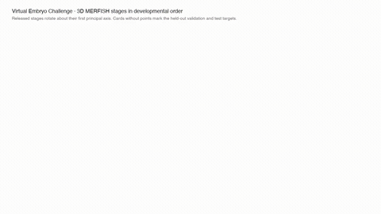

# embryo-timelapse

Turntable videos of the Virtual Embryo Challenge 3D MERFISH stages, and a renderer for any `.h5ad` with `obsm["spatial_3D"]`.



## What it shows

`timelapse.mp4` (1280x720, 30 fps, 43 s) plays the released 3D MERFISH stages in developmental order. Each released stage is a 5 s turntable of a point cloud coloured by cell type. Each held-out Task 2 target (validation and final test) appears as a 2 s card in its place. A 3 s opening card comes first.

| Stage | Setting | Shown as |
|---|---|---|
| E6.75 | embryo | released |
| E7.25 | embryo | released |
| E7.5 | embryo | held out, T2 embryo interpolation (validation) |
| E7.75 | embryo | held out, T2 embryo interpolation (final test) |
| E8.0 | embryo | released |
| E8.25 | heart | released |
| E8.5 | heart | held out, T2 heart interpolation (validation) |
| E8.75 | heart | released |
| E9.5 | heart | released |
| E10.5 | heart | held out, T2 heart extrapolation (validation) |
| E12.5 | heart | held out, T2 heart extrapolation (final test) |

Each setting has one camera scale, chosen so its largest stage spans 80% of the frame height. Growth is visible within a setting. The two settings do not share a scale. Each stage is rotated into its own principal-axis frame, so orientations are not aligned across stages.

Heart-setting frames carry this note: "Heart-setting files are crops around the heart; their size reflects the dissection, not growth." The data page says profiling "is focused on the organ of interest" in the heart setting, so the heart-stage sizes are not a growth measure.

`stages.png` has one still per stage in two rows (embryo setting, heart setting). Held-out targets are grey placeholders. `timelapse.gif` is a 480 px, 10 fps preview cut from the MP4.

## Data-page wording the labels rely on

From https://virtualembryo.ai/challenge/data:

- Validation rows: "interpolation validation, answers withheld" (E7.5, E8.5) and "extrapolation validation, answers withheld" (E10.5).
- Test rows: E7.75, "interpolation test, hidden", and E12.5, "extrapolation test, hidden".
- Final phase: "In the final phase every heart stage is training input."
- Setting: "these stages cover the entire embryo; by the stages in the heart setting it is far larger, and profiling is focused on the organ of interest instead."
- Brackets: E7.25 is the "last stage before the held-out pair"; E8.0 is "the stage after the pair, both targets are bracketed".
- Files: E8.25 "ships as E8.25_late.h5ad".
- Frames: "The frame is per-embryo local and is not registered across time points".

Board keys and the validation list come from https://virtualembryo.ai/challenge/panels/index.json (`T2:embryo:val_interp`, `T2:heart:val_interp`, `T2:heart:val_extrap`).

Not shown: Task 1 (single-cell, no coordinates) and the Task 3 knock-out conditions. The `E8.5_RNA` and `E9.5_RNA` files are single-cell and have no `spatial_3D`, so they are not used.

## Run

Needs ffmpeg on PATH (H.264 output).

```
python render.py FILE.h5ad --out out.mp4
python render.py FILE.h5ad --compare REF.h5ad --out side_by_side.mp4
python render.py FILE.h5ad --color GENE --out gene.mp4
python timelapse.py --data-dir DATA_DIR      # DATA_DIR holds E8.75.h5ad and E9.5.h5ad
python palette.py --data-dir DATA_DIR        # rebuild palette.json if stages.json changes
python -m pytest -q test_render.py
```

`DATA_DIR/.stage_cache/` holds E6.75, E7.25, E8.0 and E8.25_late. Use `--stage-cache` to point elsewhere. `render.py` also takes `--cells` (default 15000), `--seconds`, `--fps`, `--size` and `--seed`.

Dependencies: anndata, numpy, pandas, scipy, matplotlib (and pytest for the tests).

## Limits

- Each stage is a random subsample of at most 15,000 cells (seed 0). The legend counts use the whole file.
- Cell-type labels are as released. A colour means the same thing across stages only for identical label strings.
- The released stages hold 66 labels. Each gets its own colour, but many are close in hue, so the legend shows only the top 12 by count.
- Heart-setting sizes reflect the crop (see above), not growth. Embryo-setting frames are whole embryos.
- Gene colours use the stored values. The released `.X` is log-normalised; raw integer counts get log1p.
- The turntable is a display choice. It does not align coordinates across stages, and the coordinate frames are per embryo.

## Files

- `render.py`: turntable renderer for one file, or two side by side (`--compare`).
- `timelapse.py`: builds `timelapse.mp4`, `timelapse.gif` and `stages.png` from `stages.json`.
- `stages.json`: stage order, setting, and held-out labels.
- `palette.py`, `palette.json`: fixed cell-type colours.
- `test_render.py`: tests for rotation, palette, scale and short renders.
