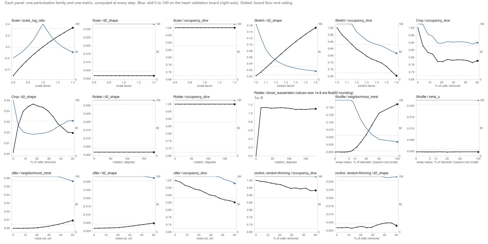

# Metric movies: what moves each Task 2 spatial metric

Where [random-guy-05/vec-failure-gallery](https://github.com/random-guy-05/vec-failure-gallery) shows static failure plates with likely metric signatures, these clips compute each spatial metric live with the pinned veckit scorer along a continuous dose-response, and show the response as video.

On the heart boards, `d2_shape` (tissue shape) is where the top 20 teams differ most. In the `leaderboard-anatomy` snapshot, the top-20 spread is 1.9 board points on heart interpolation and 4.6 on heart extrapolation, the widest of any metric on both boards.



## Clips

Each clip is 9 s, 1280x720, 30 fps, H.264. Left: the prediction point cloud (fixed oblique camera) over the truth as a faint grey ghost. Right: each metric against the perturbation strength, drawn up to the current step, with a skill line (0 to 100) and a readout in board points.

| Clip | Perturbation | Metrics | Strength steps |
|---|---|---|---|
| `videos/scale.mp4` | isotropic scale of the truth about its centroid, 0.6 to 1.4 | scale_log_ratio, d2_shape, occupancy_dice | 15 |
| `videos/stretch.mp4` | stretch along the long axis by s, across by 1/sqrt(s) (volume kept), 1.0 to 1.6 | d2_shape, occupancy_dice | 13 |
| `videos/crop.mp4` | slab removed from one end, 0 to 50% of cells | occupancy_dice, d2_shape | 13 |
| `videos/rotate.mp4` | proper rotation about the long axis, 0 to 180 degrees | d2_shape, occupancy_dice, sliced_wasserstein | 13 |
| `videos/shuffle.mp4` | expression swapped between paired cells within a growing radius, 0 to the full diameter | neighborhood_mmd, mmd_u | 13 |
| `videos/jitter.mp4` | Gaussian position noise, sd 0 to 50 um | neighborhood_mmd, d2_shape, occupancy_dice | 13 |

Control, not a video (in `responses.csv` and the summary): `crop_random_control` removes the same share of cells at random instead of as a slab.

### What the computed curves show

- **Scale.** scale_log_ratio equals the log of the scale factor exactly. It loses 5.1 points at 0.6 and 4.2 points at 1.4. d2_shape (0.00167) and occupancy_dice (1.000) do not change at any scale.
- **Stretch.** d2_shape loses the most of any shape metric here: from 8.3 points to 1.3 at 1.6 (value 0.0017 to 0.153), and it has already lost 2.1 points at 1.05. occupancy_dice falls to 0.654 and loses 4.4 points.
- **Crop.** occupancy_dice drops to 0.878 once 4% of cells are removed, then stays between 0.76 and 0.79 from 17% onward, losing 2.8 points at 50%. d2_shape rises to 0.046 at 17% removed (losing 5.1 points), then falls back to 0.020 at 50% (losing 3.1 points), so it is not monotone in the share removed. In the random-thinning control at 50%, occupancy_dice is 0.93 and keeps its full points. The slab gives 0.78 at the same count.
- **Rotate.** Nothing moves. d2_shape (0.00167), occupancy_dice (1.000) and sliced_wasserstein (about 1e-8, float32 rounding) are the same at every angle from 0 to 180 degrees. Both shape metrics keep their full 8.3 points throughout.
- **Shuffle.** neighborhood_mmd keeps full points until the swap radius reaches about 6% of the cloud diameter. At 25% it has lost half its points (12.5 of 25), and at the full diameter it is 0.161 (6.3 of 25). Swaps reach 14% of cells at a 1% radius and 91% at 4%. mmd_u stays at about -0.0003 at every radius. It is always below its board ceiling (0.00087), so it keeps all 15 points in every step.
- **Jitter.** neighborhood_mmd keeps full points to about 40 um, then loses 2.1 points by 50 um (value 0.0092). occupancy_dice falls to 0.851 and loses 1.0 point. d2_shape reaches 0.0048 and loses 0.2 points.

Largest loss at the strongest step, in board points (of its maximum): shuffle neighborhood_mmd 18.7 of 25 (full radius); stretch d2_shape 7.1 of 8.3 (1.6); scale scale_log_ratio 5.1 of 8.3 (0.6); crop d2_shape 3.1 of 8.3 at 50%; jitter neighborhood_mmd 2.1 of 25 (50 um); rotate 0.

## Scorer, data and conversion to skill

- **Scorer.** veckit GitHub main cc3859a, which includes the issue #7 rotation fix. compute.py loads the T2 metric modules with the scorer's own loader and calls the same functions that `score_task2_v2` calls, with the same arguments and `seed=0`: `d2_distance`, `occupancy_dice`, `sliced_wasserstein`, `scale_log_ratio`, `neighborhood_mmd` and `mmd_unbiased`.
- **Check.** `--verify` runs the full `veckit.score()` T2 path on four steps (scale 1.4, shuffle 0.5, crop 0.3, rotate 90) and compares 20 metric values. All 20 match after the scorer's rounding.
- **Truth.** A fixed random subsample of 4,000 of the 53,742 cells in the released E9.5 file (`numpy.random.default_rng(0)`). 500 genes, X finite and non-negative (log-normalised), 22 cell types. `obsm["spatial_3D"]` is used as released. The file does not state its units, so the jitter axis is read as micrometres.
- **Skill and points.** `../metric-lens/vec_metric_lens.py` (`metric_skill`, `anchored_board`), using the floors and ceilings from `T2:heart:val_interp` in panels/index.json and the board weights. A metric at its floor has skill 0.5 and one at its ceiling has skill 1. Points = 100 x weight x skill. Saved copy of the board block: `anchors_T2_heart_val_interp.json`.
- **Anchors are a yardstick only.** They come from the validation heart-interpolation board (E8.5). They convert metric values into skill and points for display. Nothing here selects, tunes or scores a submission.

## Limits

- **One stage, one subsample, one seed.** The truth is E9.5, the anchors are from E8.5, and there is one 4,000-cell subsample. Values depend on the subsample, most visibly for occupancy_dice.
- **occupancy_dice resolution is below the scorer's own guidance.** At 4,000 cells, the voxel edge is 5.2 to 6.8 times the truth's median nearest-neighbour spacing. The scorer's docstring asks for about 10 before the Dice value is read as tissue overlap. Part of the occupancy movement here is therefore sampling density. A denser subsample was not tested.
- **Count matching.** The scorer subsamples both clouds to the smaller count. Crop therefore changes occupancy_dice partly through count. The random-thinning control separates the two (0.93 vs 0.78 at 50%).
- **Board ceilings hide differences.** Any value at or below a ceiling gets full skill, so several curves sit at 100 for a while. The truth itself already scores d2_shape 0.0017 (ceiling 0.0041) and occupancy_dice 1.000 (ceiling 0.880). This is how the board works, not a bug.
- **mmd_u cannot see these shuffles.** It is always below its ceiling in this set-up, and the shuffle keeps the expression rows the same.
- **sliced_wasserstein has no anchor on this board.** It is shown without skill, and its values near 1e-8 are float32 rounding after rotation.
- **Rotation check is for this scorer only.** The flat rotate curves show the pinned scorer's fix. An older scorer was not run to show the contrast.
- **Colour in shuffle.** Colour is the cell type of the expression a point now carries. The points themselves do not move.

## Run

```bash
# 1. Pinned scorer env: veckit at GitHub main cc3859a (already installed in the vec-community-work envs)
SCORER_PY=/path/to/envs/git-main-cc3859a/bin/python

# 2. Compute responses.csv and the per-step cache (about 1 minute; --verify adds about 20 s)
$SCORER_PY compute.py --data /path/to/E9.5.h5ad --verify

# 3. Render videos and summary.png (needs numpy, matplotlib, ffmpeg on PATH; about 1 minute)
python render.py --ffmpeg ffmpeg

# 4. Perturbation checks, on synthetic clouds (needs numpy, pytest)
python -m pytest test_compute.py
```

The data path can also be given as the `VEC_E95` environment variable. The board anchors are read from the public index. If that is unreachable, compute.py uses the copy saved in `cache/index.json` by an earlier run, or `--index PATH` takes a local copy. The anchors used for the published curves are in `anchors_T2_heart_val_interp.json`.

## Files

- `compute.py`: perturbations, scorer calls, per-step cache in `cache/` (git-ignored), `responses.csv`, `run_info.json`, `anchors_T2_heart_val_interp.json`, and the `--verify` check.
- `render.py`: frames and H.264 encoding for the six videos, plus `summary.png`.
- `test_compute.py`: scale, stretch, rotation, shuffle, crop, jitter and random-control checks.
- `responses.csv`: clip, strength (scale factor, fraction removed, degrees, swap radius as a fraction of diameter, or noise sd in um), metric, value, skill (0 to 100), points.
- `run_info.json`: subsample, scorer, timings, occupancy resolution range, shuffle fraction moved, verification results.
- `videos/`: the six clips, under 5 MB in total.
